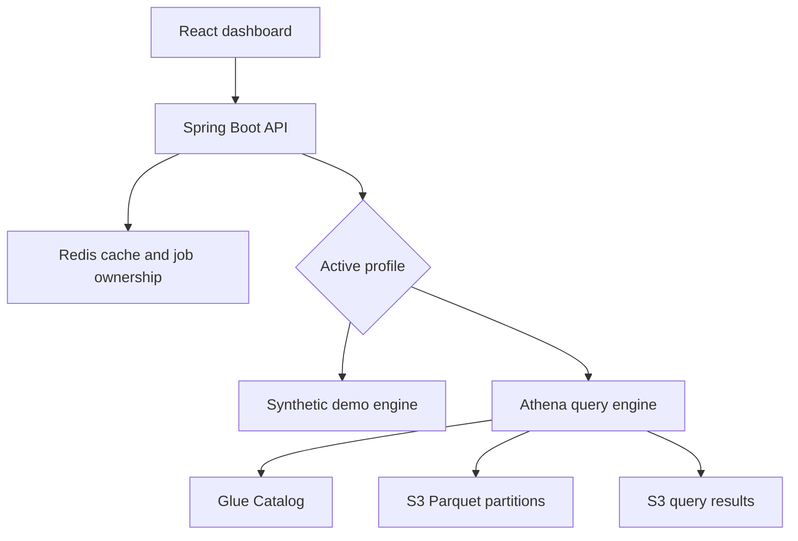

# S3 Analytics Dashboard

## Public interactive demo

[Open S3 Analytics Lab](https://s3-analytics-lab-muhammad.zanydove8193.chatgpt.site)

The public demo uses synthetic data and simulates queries and caching entirely in the browser. It does not contact Spring Boot, Redis or AWS. Its standalone source is in `demo/index.html`. The full backend and React project can be run locally with Docker Compose as described below.

A learning project demonstrating a Spring Boot API, React dashboard, Redis result caching, and asynchronous Athena queries over partitioned S3 data.

**Demo data is synthetic. This project has not been benchmarked against a multi-terabyte dataset and does not represent prior production work.**

## Run the local demo

Requirements: Docker with Compose. No AWS account is needed in demo mode.

```bash
docker compose up --build
```

Open http://localhost:5173. Sign in through the dashboard fields using `demo` / `demo-change-me`. Run October 1–7, then run the same dates again to observe a Redis cache hit. Redis is required even in demo mode.

Ports are bound to loopback. The frontend uses Vite's development server: this Compose setup is for local development, not public hosting.

To change demo credentials, set `APP_USERNAME` and `APP_PASSWORD` in a local `.env` file, then enter those values in the dashboard. Do not commit `.env`.

## Architecture



The UI starts a query and polls without keeping a backend HTTP request open for the full query duration. Successful daily summaries expire from the shared result cache after five minutes. Individual job outcomes and ownership expire after 24 hours. Redis keys are scoped to the authenticated username. Query cancellation is exposed through DELETE.

## Run without Docker

Requirements: Java 17+, Maven 3.9+, Node 22+, Redis.

```bash
# Terminal 1: start Redis using your local installation
redis-server

# Terminal 2
cd backend
mvn spring-boot:run

# Terminal 3
cd frontend
npm ci
npm run dev
```

## AWS profile

1. Create a curated S3 prefix containing Parquet files with `transaction_id` and decimal `amount`, partitioned into `event_date=YYYY-MM-DD/` folders.
2. Create an `analytics` Glue database. Adapt and run `infra/athena.sql` to register the table and partitions.
3. Configure an Athena workgroup with query scan limits and an S3 results location.
4. Give the backend's IAM role least-privilege access to Athena queries, the configured workgroup, Glue table metadata, source S3 objects and results S3 objects. Add KMS permissions if applicable. Do not embed AWS keys in source code.
5. Run Redis and start the backend with configuration matching your account:

```bash
export SPRING_PROFILES_ACTIVE=aws
export AWS_REGION=us-east-1
export ATHENA_DATABASE=analytics
export ATHENA_WORKGROUP=analytics-demo
export ATHENA_OUTPUT=s3://YOUR-RESULTS-BUCKET/queries/
export APP_USERNAME=analyst
export APP_PASSWORD='choose-a-strong-password'
cd backend
mvn spring-boot:run
```

AWS queries can incur charges. The app returns at most 31 daily aggregates, not raw transaction detail. Athena reads the partitions selected by the date predicate; efficiency also depends on file layout, column selection and partition configuration.

The SDK uses its default credentials chain. For local AWS development, configure your own AWS CLI/SSO credentials. The supplied Compose file intentionally starts only demo mode.

## API

All endpoints require HTTP Basic authentication. Mutating requests also require a CSRF token. The browser client fetches `/api/csrf` and returns the provided token/header before POST or DELETE.

| Method | Path | Purpose |
|---|---|---|
| GET | `/api/csrf` | Obtain a CSRF token |
| POST | `/api/queries` | Start query or return cached summary |
| GET | `/api/queries/{id}` | Read status/results for a query owned by this user |
| DELETE | `/api/queries/{id}` | Cancel an owned query |

Example POST body:

```json
{"start":"2026-10-01","end":"2026-10-07"}
```

## Validation

```bash
mvn -B -f backend/pom.xml verify
cd frontend
npm ci
npm run build
```

Unit tests cover invalid date ranges, cache hits bypassing the query engine, job ownership enforcement, result TTL, and query cancellation when job registration fails. API tests also cover authentication, CSRF enforcement, token retrieval and authenticated query submission. GitHub Actions runs backend tests and the frontend production build.

## Deliberate sample limitations

- Single shared dataset and a single configurable demo account. User-scoped cache keys do not enforce customer-level row security; implement tenant authorization and query predicates before using private multi-tenant data.
- Basic authentication with a demo password encoder is for local illustration. Use an identity provider, an appropriate password encoder and HTTPS for real deployment.
- Redis failures fail requests rather than silently discarding query ownership. Add controlled retries, metrics and durable job orchestration as needed.
- Concurrent identical requests can start duplicate queries. Poll/cancel transitions are not an atomic distributed state machine. Add deduplication locks, reconciliation and cancellation race handling for production.
- Demo engine jobs live in memory until polled or cancelled. Restarting the backend loses unfinished demo jobs. Abandoned demo jobs need scheduled cleanup for long-lived use.
- The UI stops polling after two minutes; a query may still run. Use the cancellation action or Athena console to stop it. A production worker should enforce deadlines independently.
- No raw-record pagination or export pipeline is included. Add those as separate endpoints with bounded responses.
- AWS access, large-scale performance and full Docker integration require validation in your own environment.

## Interview walkthrough

Explain the request path, why Athena performs the S3 scan, how partition pruning reduces work, why Redis caches small aggregates, and why the UI polls for long queries. Describe this as a sample you built to learn the architecture; do not claim it proves production experience at terabyte scale.
